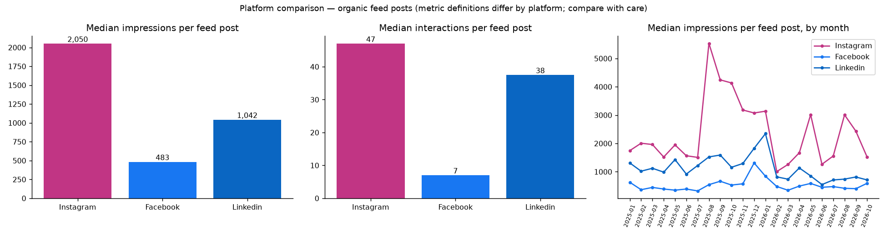
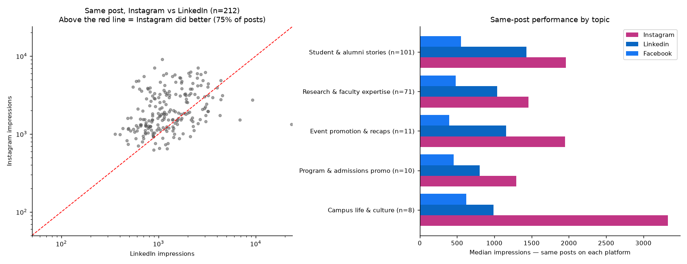

# Social Media Performance Analysis

A performance analysis of the Instagram, LinkedIn and Facebook accounts I managed for a higher-education brand. It covers **1,053 organic feed posts** from January 2025 to October 2026 and asks what to post, where, and when.

> The brand name and raw data are kept private. This repository shares the code, charts and aggregated results.

**Tools:** Python (pandas, SciPy, matplotlib)

## Questions

1. How do posts perform on each platform?
2. How does the *same* post perform on Instagram compared with LinkedIn?
3. Which topics, formats and posting times do best?
4. Why did Instagram impressions fall so sharply in fall 2026?

## Key findings

| | Instagram | LinkedIn | Facebook |
|---|---|---|---|
| Posts analyzed | 334 | 341 | 378 |
| Median impressions per post | **2,050** | 1,042 | 483 |
| Median interaction rate (÷ impressions) | 2.3% | **3.5%** | 1.2% |
| Follower growth, Jan 2025 – Oct 2026 | **+76%** | +62% | +20% |



**1. The same post reaches more people on Instagram but earns more interaction on LinkedIn.** Across 212 posts published to both, Instagram had more impressions 75% of the time. LinkedIn had more interactions 63% of the time and a higher interaction rate 86% of the time (Wilcoxon signed-rank, p < 0.001 for each).



**2. Student-focused content performs better on every platform.** Compared with other posts, it had 41% higher median reach on Instagram, and 52% and 80% higher median impressions on Facebook and LinkedIn.


**3. Carousels and multi-image posts beat single images.** Median reach or impressions were roughly 1.7 to 2.4 times as high, depending on the platform. Part of this may reflect topic, since milestone and student posts tend to be carousels.

**4. Day of week matters and time of day doesn't.** Monday was the weakest weekday on all three platforms. Friday was the strongest on Facebook and LinkedIn; on Instagram, Tuesday (1,026 median reach) edged out Friday (967). Weekday differences were significant on every platform (p ≤ 0.015). Time of day showed no significant difference.

**5. The Instagram "decline" was mostly not organic.** Profile impressions fell 75% from Jun–Aug to Sep–Oct 2026, but median organic reach per post fell only 10%. The pattern is consistent with ad delivery ending, though spend data would be needed to confirm it. The main organic change was 43% fewer feed posts.

## Recommendations

- Match content to platform: campus life on Instagram, research and outcomes on LinkedIn.
- Make student stories the core of the plan, published as carousels.
- Test moving key posts off Mondays (to Friday, or Tuesday on Instagram), and restore posting volume.
- Rework the weekly event roundups, the lowest performers on LinkedIn and Facebook.
- Report paid and organic results separately.

## Method

- **Cleaning:** separated Stories from feed posts, and excluded 47 "dark" ad posts, TikTok (5 posts) and posts under 14 days old. Facebook posts with zero recorded impressions are left out of rate and impression measures.
- **Matched posts:** the scheduling tool's shared group ID links the same content across platforms. This controls for content, but audience and algorithm still differ.
- **Topics:** rule-based classification of captions. 88% of posts matched a high-confidence rule.
- **Statistics:** medians, because the data is heavily skewed; Kruskal-Wallis for groups; Wilcoxon signed-rank for matched pairs.

**Limits:** the data is observational, so differences show association, not cause. Metric definitions vary by platform. Some groups are small (the `small_sample` column marks n < 10). P-values are not adjusted for multiple comparisons.

## Repository

```
scripts/
  prepare_posts.py       clean posts, classify topics, derive metrics
  analyze.py             topics, formats, Instagram decline, timing, growth
  same_post.py           matched cross-platform comparison
  platform_overview.py   platform summary
results/charts/          charts
results/tables/          aggregated results
org_config.example.json  template for organization-specific terms
```

## Run it on your own data

The scripts expect Vista Social CSV exports in `raw/`. Copy `org_config.example.json` to `org_config.json`, add your own terms, then:

```bash
pip install -r requirements.txt
mkdir -p prepared outputs/tables outputs/charts
python scripts/prepare_posts.py raw/<post_export>.csv prepared/posts_prepared.csv org_config.json
python scripts/analyze.py .
python scripts/same_post.py .
python scripts/platform_overview.py .
```

The published tables are a filtered subset of what the scripts produce. Dates for the export and comparison periods are set in the scripts.
