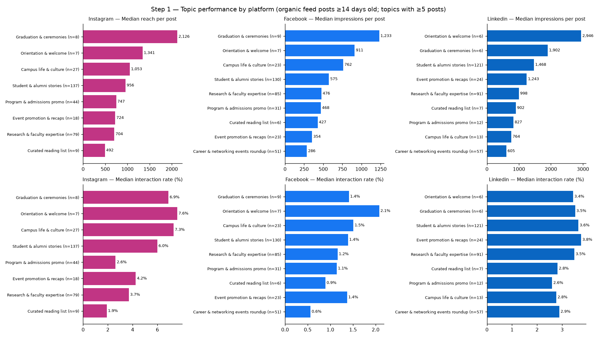

# Social Media Performance Analysis

A performance analysis of the Instagram, LinkedIn and Facebook accounts I managed for a higher-education brand. It covers **1,053 organic feed posts** from January 2025 to October 2026 and asks what to post, where, and when.

> The brand name and raw data are kept private. This repository shares the code, charts, aggregated results and an anonymized dashboard with no captions, links, IDs, exact dates or follower counts.

**[Open the interactive dashboard](https://nic-stack.github.io/social-media-analysis/)**

**Tools:** Python (pandas, SciPy, matplotlib), JavaScript (Chart.js)

**Contents:** [Questions](#questions) · [Key findings](#key-findings) · [Recommendations](#recommendations) · [Step by step](#how-i-solved-it-step-by-step) · [Repository](#repository) · [Run it](#run-it-on-your-own-data)

## Questions

1. How do posts perform on each platform?
2. How does the *same* post perform on Instagram compared with LinkedIn?
3. Which topics, formats and posting times do best?
4. Why did Instagram impressions fall so sharply in fall 2026?

## Key findings

| | Instagram | LinkedIn | Facebook |
|---|---|---|---|
| Posts analyzed | 334 | 341 | 378 |
| Median impressions per post | **2,050** | 1,042 | 483 |
| Median interaction rate (÷ impressions) | 2.3% | **3.5%** | 1.2% |
| Follower growth, Jan 2025 – Oct 2026 | **+76%** | +62% | +20% |


**1. The same post reaches more people on Instagram but earns more interaction on LinkedIn.** Across 212 posts published to both, Instagram had more impressions 75% of the time. LinkedIn had more interactions 63% of the time and a higher interaction rate 86% of the time (Wilcoxon signed-rank, p < 0.001 for each).


**2. Student-focused content performs better on every platform.** Compared with other posts, it had 41% higher median reach on Instagram, and 52% and 80% higher median impressions on Facebook and LinkedIn.



**3. Carousels and multi-image posts beat single images.** Median reach or impressions were roughly 1.7 to 2.4 times as high, depending on the platform. Part of this may reflect topic, since milestone and student posts tend to be carousels.

**4. Day of week matters and time of day doesn't.** Monday was the weakest weekday on all three platforms. Friday was the strongest on Facebook and LinkedIn; on Instagram, Tuesday (1,026 median reach) edged out Friday (967). Weekday differences were significant on every platform (p ≤ 0.015). Time of day showed no significant difference.

**5. The Instagram "decline" was mostly not organic.** Profile impressions fell 75% from Jun–Aug to Sep–Oct 2026, but median organic reach per post fell only 10%. The pattern is consistent with ad delivery ending, though spend data would be needed to confirm it. The main organic change was 43% fewer feed posts.

## Recommendations

- Match content to platform: campus life on Instagram, research and outcomes on LinkedIn.
- Make student stories the core of the plan, published as carousels.
- Test moving key posts off Mondays (to Friday, or Tuesday on Instagram), and restore posting volume.
- Rework the weekly event roundups, the lowest performers on LinkedIn and Facebook.
- Report paid and organic results separately.

## How I solved it, step by step

### The problem

The same content was going out on Instagram, LinkedIn and Facebook, but nobody could say what was working or where. Instagram impressions had also dropped sharply in fall 2026, and it looked as if the content was failing. I needed to answer the four questions above using only the scheduling tool's exports.

### Step 1: Understand the data

I started with a post-level export of 3,252 records plus daily profile metrics, daily breakdowns and audience snapshots. Profiling them first turned up problems that would have distorted the results:

| Problem | Why it matters | What I did |
|---|---|---|
| 63% of records were Stories | They behave differently from feed posts | Analyzed them separately |
| 47 "dark" posts (ad versions never shown on the page) | They inflate post counts and are not organic | Removed them |
| 35 Facebook posts with zero recorded impressions | They break rates and drag medians down | Left out of impression and rate measures |
| Posts published just before the export | They had not finished collecting results | Removed posts under 14 days old |
| One LinkedIn post with about 300,000 impressions (the median is 1,042) | It would dominate any average | Used medians |
| Clicks were about 83% of LinkedIn's "engagement" | Engagement is not comparable across platforms | Built my own interaction measure |
| Metrics that read zero after reporting changes | They look like real drops | Excluded them or used another field |

### Step 2: Define the posts to analyze

| | Records |
|---|---|
| All exported records | 3,252 |
| Minus Stories | −2,131 |
| Minus dark posts | −47 |
| Minus TikTok (too few posts to analyze) | −5 |
| Minus posts under 14 days old | −16 |
| **Feed posts analyzed** | **1,053** |

### Step 3: Make the platforms comparable

Each platform defines engagement differently. For cross-platform comparisons I used interactions = likes + comments + shares, and interaction rate = interactions ÷ impressions. For Instagram-only results I used reach and included saves.

### Step 4: Classify topics

The export had no usable topic labels, so I wrote ordered keyword rules based mainly on each caption's opening line, with the first match winning. Each post got a topic, a confidence level, and flags such as student-focused and campus life. I checked samples by hand. 91% of the analyzed posts matched a high-confidence rule and 11 stayed unclassified.

### Step 5: Match the same post across platforms

Comparing platform averages mixes up the platform with what was posted there. The scheduling tool gives each piece of content a shared group ID, which let me match **212 posts published to both Instagram and LinkedIn**. This holds the content constant, so the difference reflects the platform and its audience.

### Step 6: Test the differences

- **Medians**, because the data is heavily skewed.
- **Kruskal-Wallis** to compare topics, formats, weekdays and times of day within each platform.
- **Wilcoxon signed-rank** for the matched posts, since each pair is the same content.
- Groups with fewer than 10 posts are marked as small samples.

### Step 7: Explain the Instagram drop

I broke the decline into parts, comparing Jun–Aug with Sep–Oct 2026:

| Monthly average | Jun–Aug 2026 | Sep–Oct 2026 | Change |
|---|---|---|---|
| Profile impressions | 1,172,318 | 298,426 | **−75%** |
| Median reach per feed post | 969 | 871 | −10% |
| Feed posts | 15.7 | 9.0 | **−43%** |
| Median interactions per post | 49 | 66 | +35% |

Reach per post barely moved and interactions rose, so weaker content does not explain a 75% drop. Profile impressions were far larger than all post impressions combined, which points to ads. Reach per post fell 15% over the same months in 2025, so a small fall dip looks seasonal. The organic problem was fewer posts.

### Step 8: Build the deliverables

I turned the results into recommendations, a slide deck, a written report and the [interactive dashboard](https://nic-stack.github.io/social-media-analysis/).

### Step 9: Check the work

I reran the pipeline and compared its tables with the originals, then checked the write-up against the charts. That caught a claim that Friday was the best day everywhere (on Instagram it is Tuesday) and a dashboard filter that dropped one matched post. Both are corrected here.

### Limitations

- The data is observational. Topic, format and timing overlap, so differences show association, not cause.
- Platforms define their metrics differently, and matched posts still reach different audiences.
- There was no ad spend data, so the paid explanation for the Instagram drop is likely but not confirmed.
- Topics come from keyword rules, and some groups are small.
- P-values are not adjusted for multiple comparisons.

### What I would do next

- Add ad spend data to separate paid and organic results.
- Run a controlled test of calls to action that ask people to comment or tag someone.
- Replace the keyword rules with a model trained on hand-checked labels.

## Repository

```
scripts/
  prepare_posts.py       clean posts, classify topics, derive metrics
  analyze.py             topics, formats, Instagram decline, timing, growth
  same_post.py           matched cross-platform comparison
  platform_overview.py   platform summary
  build_dashboard.py     builds the anonymized dashboard
  dashboard_template.html
docs/index.html          interactive dashboard (Chart.js, MIT license, included)
results/charts/          charts
results/tables/          aggregated results
org_config.example.json  template for organization-specific terms
```

## Run it on your own data

The scripts expect Vista Social CSV exports in `raw/`. Copy `org_config.example.json` to `org_config.json`, add your own terms, then:

```bash
pip install -r requirements.txt
mkdir -p prepared outputs/tables outputs/charts
python scripts/prepare_posts.py raw/<post_export>.csv prepared/posts_prepared.csv org_config.json
python scripts/analyze.py .
python scripts/same_post.py .
python scripts/platform_overview.py .
```

The published tables are a filtered subset of what the scripts produce. Dates for the export and comparison periods are set in the scripts.
